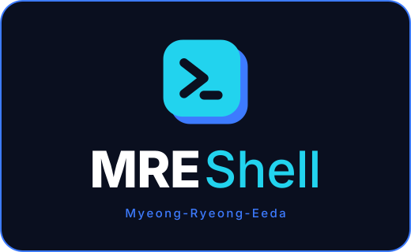
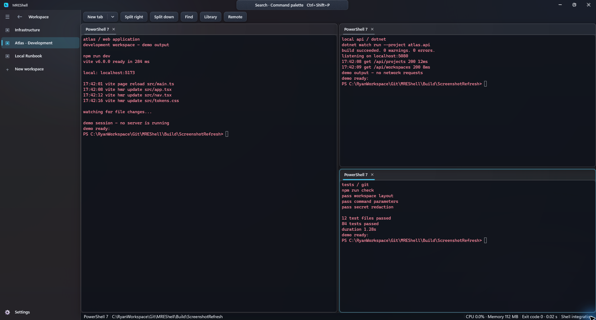
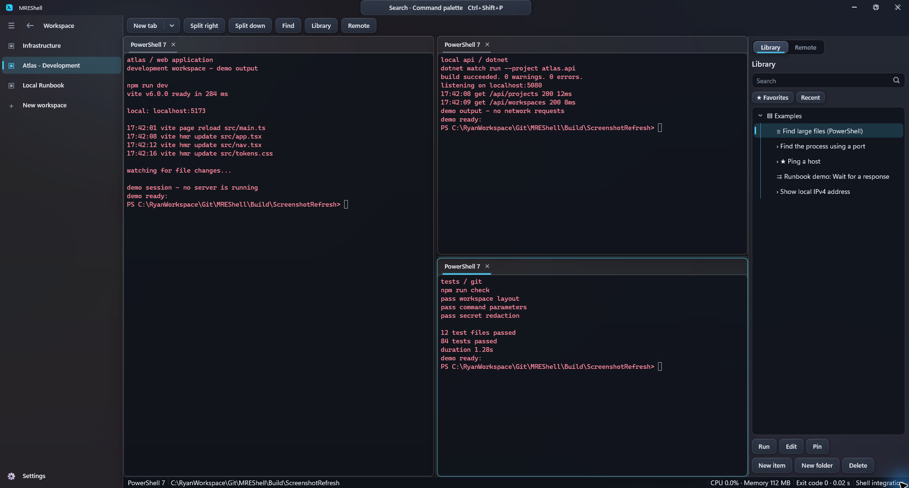
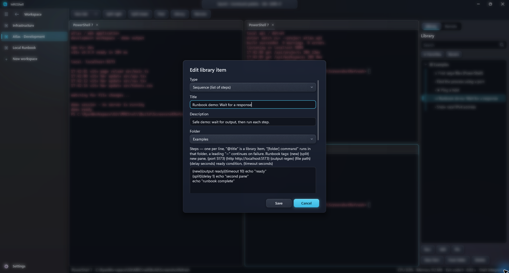
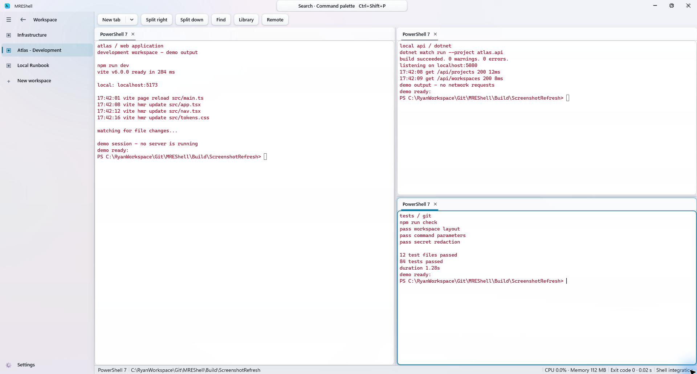
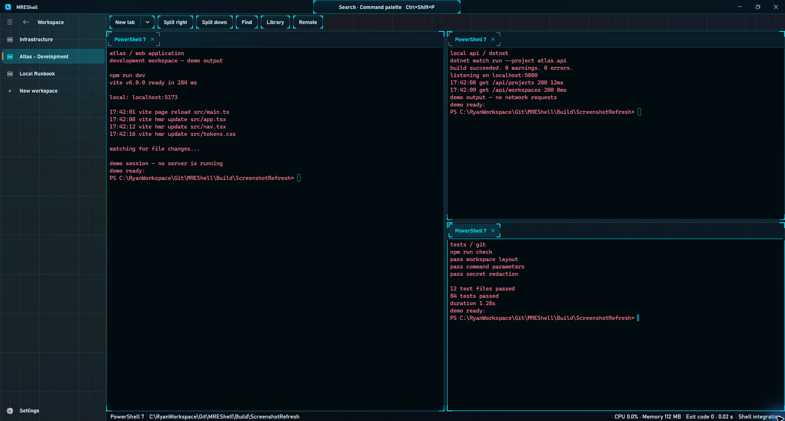
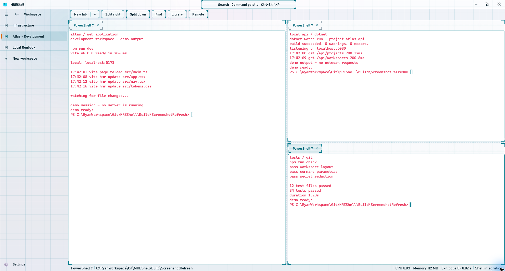
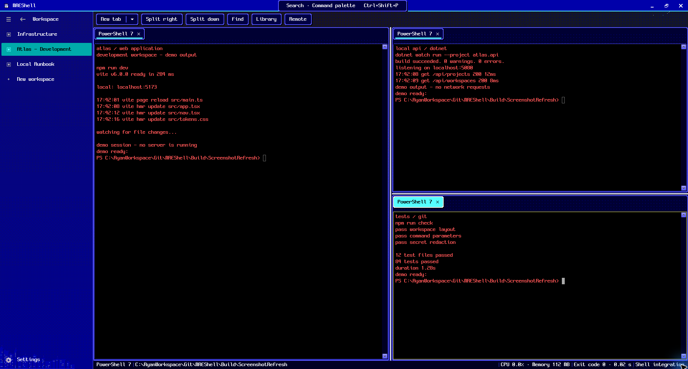
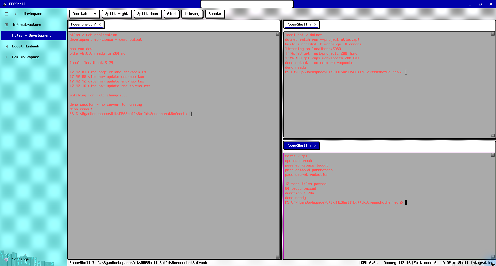
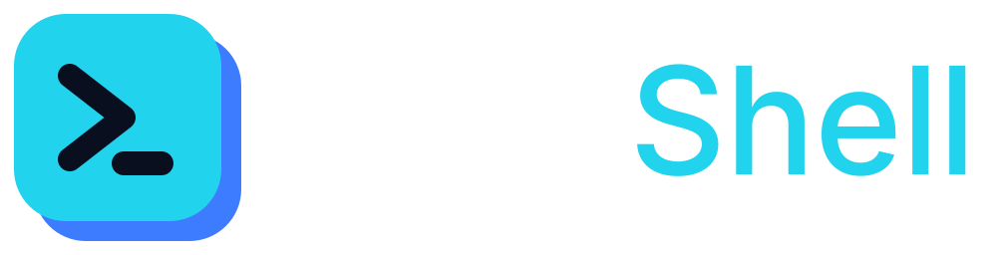

<p align="center">
  
</p>

<h1 align="center">Too many terminals. Not enough desk.</h1>

<p align="center">
  <strong>Give your shells, commands, and projects a place to call home.</strong><br>
  A free, native terminal for Windows 11.
</p>

<p align="center">
  <strong>MRE</strong> stands for <strong>Myeong-Ryeong-Eeda</strong> (명령이다), Korean for <strong>“It is a command.”</strong><br>
  <sub>A commanding name. You still call the shots.</sub>
</p>

<p align="center">
  <strong>Windows 11 x64</strong> &nbsp; · &nbsp;
  Free for personal &amp; commercial use &nbsp; · &nbsp;
  No account required
</p>

<p align="center">
  <a href="https://github.com/YiMunDong/MREShell-Release/releases/download/v1.2.0-preview.1/MREShell.exe"><strong>Download MREShell.exe →</strong></a>
  &nbsp;&nbsp; · &nbsp;&nbsp;
  <a href="#screenshots">Explore the screenshots</a>
  &nbsp;&nbsp; · &nbsp;&nbsp;
  <a href="#get-started">Get started</a>
</p>

---

**Available now: MREShell 1.2.0 Preview 1** · App version `1.2.0.0` · 7.6 MB · [Release notes](https://github.com/YiMunDong/MREShell-Release/releases/tag/v1.2.0-preview.1)

This preview requires the [Microsoft Visual C++ x64 Redistributable](https://aka.ms/vc14/vc_redist.x64.exe). The executable is **unsigned**. Clean Windows 11 VM validation is pending; this is not a release candidate.

## Your shells have been through enough. Give them a home.

The API is in one window. The web app is in another. That command that worked yesterday? Somewhere in your history.

MREShell brings your terminals, projects, and reusable commands together in one Windows application. Keep a web app, an API, and your checks side by side. Give every project its own workspace. Save the commands worth remembering, then bring them back with a shortcut.

Use **PowerShell, Command Prompt, WSL, Git Bash, or a developer prompt**. MREShell hosts the shells you already use and adds practical tools around them.

<a href="assets/screenshots/workspace.png">
  
</a>

<p align="center"><sub>One project. Three terminals. No window hide-and-seek. Click any screenshot to open it at full size.</sub></p>

## Why MREShell?

| Make your day easier | What you can do |
| --- | --- |
| **Keep projects organized** | Switch workspaces from the sidebar. Arrange terminal tabs, splits, and floating windows, then restore the saved layout next time. |
| **Stop retyping useful commands** | Build a command and script library with folders, tags, favorites, workspace pins, and parameters such as `{{branch}}` or `{{port}}`. |
| **Find your next action quickly** | Open the command palette with **Ctrl+Shift+P**. Insert a command for review, execute it, or send it to a new tab or split. |
| **Bring a workflow together** | Connect steps in a runbook. Wait for a port, an HTTP response, a file, or matching output before continuing. |
| **Work locally and remotely** | Save SSH and serial sessions. Restore remote panels with a workspace and reconnect after a disconnect. |
| **Keep the context** | Shell integration records command boundaries, working directories, exit codes, and duration. Revisit activity through the command journal. |
| **Share with more care** | Secret Shield masks recognized secrets when copying, saving to the journal, or exporting. Paste checks and risk prompts help you review commands. |
| **Make it your own** | Choose from three theme families, light and dark modes, editable shortcuts, and five interface languages. |

### A small app with room for real work

- **One executable.** A native C++ application, with no separate app resource folder or runtime download. The Microsoft Visual C++ x64 Redistributable is required.
- **Your data stays local.** Settings, command libraries, and journals live on your computer. No account or telemetry.
- **Useful tools close at hand.** Quick terminal, terminal search, completion notifications, and built-in text, Markdown, and image viewers.
- **Five interface languages.** English, Korean, Japanese, Simplified Chinese, and Traditional Chinese.
- **Free to put to work.** Personal projects, education, and commercial work are covered by the [MREShell license](LICENSE.md).

## It worked yesterday. Save it for tomorrow.

**1. Give the project a home.** Create a workspace and arrange the terminals you need. The sidebar keeps projects separate; tabs and splits keep related work together.

**2. Save what works.** Save a command you just used with **Ctrl+Shift+S**. Turn changing values into parameters, organize the recipe, and pin it to a workspace. Your command history can retire from its second job as a filing cabinet.

```powershell
git switch {{branch}}
```

*Example of a saved command template. MREShell asks for the parameter value before preparing the command.*

**3. Connect the steps.** Build a runbook for the sequence you repeat. Use readiness conditions to wait until the next service or task is ready.

## Screenshots

These are **actual MREShell app captures** using a fictional Atlas project. Terminal output is staged to illustrate a development environment; the services, commit history, and test counts are demonstration data.

### Reusable commands, ready when you need them

Browse saved PowerShell commands and runbooks beside a three-pane workspace. These examples are staged and safe to review.

<a href="assets/screenshots/recipes.png">
  
</a>

### A local development runbook example

A safe three-step example: wait for terminal output, open a new split after a short delay, and finish. The editor shows each step before you run it.

<a href="assets/screenshots/runbook.png">
  
</a>

## Same commands. Different mood. Same typos.

Choose **Titanium Glass**, **Holo HUD**, or **Hyper80s**, with light and dark modes. These actual app captures use the same fictional Atlas workspace so you can compare their appearance. Click an image for the full-size view.

### Titanium Glass

A restrained, glass-inspired interface for everyday work. For when your terminal should be the calm part of your day.

| Dark | Light |
| :---: | :---: |
| [](assets/screenshots/themes/titanium-glass-dark.png) | [](assets/screenshots/themes/titanium-glass-light.png) |

### Holo HUD

A technical, heads-up-display style with distinctive panel outlines and accents. Mission control, even if the mission is fixing a missing semicolon.

| Dark | Light |
| :---: | :---: |
| [](assets/screenshots/themes/holo-hud-dark.png) | [](assets/screenshots/themes/holo-hud-light.png) |

### Hyper80s

A retro-inspired interface with pixel typography and a bold visual character. Your build may be modern. Your terminal can still have an arcade phase.

| Dark | Light |
| :---: | :---: |
| [](assets/screenshots/themes/hyper-80s-dark.png) | [](assets/screenshots/themes/hyper-80s-light.png) |

## Get started

1. **Check the requirements.** Windows 11 (build 22000 or later), an x64 PC, and the [Microsoft Visual C++ x64 Redistributable](https://aka.ms/vc14/vc_redist.x64.exe).
2. **[Download MREShell 1.2.0 Preview](https://github.com/YiMunDong/MREShell-Release/releases/download/v1.2.0-preview.1/MREShell.exe).** Read its release notes, then run `MREShell.exe`.
3. **Make it yours.** Choose your language, default shell, and appearance. Create a workspace and start building your command library.

Optional shells such as PowerShell 7 and Git Bash must be installed separately. SSH connections use the Windows OpenSSH Client.

<p align="center">
  <a href="https://github.com/YiMunDong/MREShell-Release/releases/download/v1.2.0-preview.1/MREShell.exe"><strong>Get MREShell.exe for Windows →</strong></a>
</p>

## Day job by day. “Just one more feature” by night.

MREShell is a personal project developed in my spare time alongside a full-time job. The development team is me, and occasionally a very optimistic to-do list.

Feedback, ideas, and bug reports are welcome. Replies and updates may take some time, especially when the day job insists on being a day job.

I read suggestions and do my best to incorporate them where possible. Thanks for trying MREShell, sharing what could be better, and being patient while I work through the list.

**[Share feedback or report an issue →](https://github.com/YiMunDong/MREShell-Release/issues)**

## Frequently asked questions

<details>
<summary><strong>Is MREShell free for work?</strong></summary>

Yes. The license permits free personal, educational, corporate, commercial, and governmental use. MREShell is proprietary freeware; its source code is not distributed. See the [full license agreement](LICENSE.md) for the terms.

</details>

<details>
<summary><strong>Does it replace PowerShell or cmd?</strong></summary>

MREShell is a terminal host. Your commands still run in the shell you choose. It adds workspaces, a command library, and workflow tools around those shells. Available shells depend on what is installed on your PC.

</details>

<details>
<summary><strong>Can I use it in portable mode?</strong></summary>

Yes. Create an empty file named `MREShell.portable` next to `MREShell.exe`. MREShell will keep its data in a `data` folder beside the executable. The Microsoft Visual C++ x64 runtime is still required.

</details>

<details>
<summary><strong>What gets restored when I reopen the app?</strong></summary>

Workspace and panel layouts are saved so you can return to the same arrangement. Restoring the layout starts new shell sessions; it does not resume previously running processes.

</details>

<details>
<summary><strong>Do I need an account or an AI subscription?</strong></summary>

No. Core terminal and workflow features require neither an account nor an AI subscription. Remote connections and runbook readiness checks use the destinations you configure.

</details>

<details>
<summary><strong>Does Secret Shield catch every secret?</strong></summary>

Secret Shield masks recognized patterns on supported copy, save, and export paths. Masking and risk checks are best-effort aids. Review commands before executing them and review output before sharing it.

</details>

---

<p align="center">
  
</p>

<p align="center">
  <a href="https://github.com/YiMunDong/MREShell-Release/releases">Releases</a>
  &nbsp; · &nbsp;
  <a href="https://github.com/YiMunDong/MREShell-Release/issues">Feedback</a>
  &nbsp; · &nbsp;
  <a href="LICENSE.md">License</a>
  &nbsp; · &nbsp;
  <a href="assets/brand/NOTICE.md">Brand credits</a>
</p>

<p align="center"><sub>© 2026 YiMunDong. All rights reserved.</sub></p>
